# Validated partner solutions for Azure Local Sovereign Private Cloud

This article summarizes the independent software vendor (ISV) partners that validated their solutions on Azure Local. These solutions help you build and operate resilient **Sovereign Private Cloud** environments while you keep control over data, security, compliance, and operational boundaries. These partners span the broader operational ecosystem that Azure Local customers rely on, from monitoring and security to data platforms, application services, identity, and, most directly, backup, disaster recovery, and migration. Together, they help customers address the operational requirements of regulated industries, government agencies, critical infrastructure providers, and organizations pursuing sovereign cloud strategies. The solutions are organized into four categories: Security & Identity, Data Streaming & AI, Business Continuity & Migration, and Application Platform & DevOps. Each category is framed according to its actual role: Business Continuity & Migration directly supports virtual machine (VM) resiliency, business continuity, and recovery objectives, while the remaining three categories represent platform and ecosystem validations that enhance the overall security, manageability, and operational readiness of Sovereign Private Cloud deployments, without serving as resiliency tools themselves.

## How we validate

We don't treat validation as a logo exercise. Our focus is on technical validation that gives customers greater clarity about supported configurations and integration scenarios. Each partner solution goes through a structured process:

- **Architecture validation:** Microsoft and the ISV review the solution architecture for Azure Local, including its deployment pattern, dependencies, and integration points.

- **Lab and product validation:** Partner solutions undergo testing against defined scenarios and configurations to evaluate their operation on Azure Local.

- **Deployment-specific validation:** Validation scope is documented by supported deployment configuration, which might include connected deployments, disconnected operations, or multi-rack environments, as applicable.

That last point matters. Every validated solution comes with documented information about the capabilities, scenarios, and configurations evaluated. We'd rather be precise than broad, because customers make architecture and procurement decisions based on what we publish.

## Validated solutions at a glance

*Directly validated by ISVs on Azure Local platforms, either in Microsoft-provided labs or in their own Azure Local labs.*

| | | | | | |
|:---:|:---:|:---:|:---:|:---:|:---:|
| [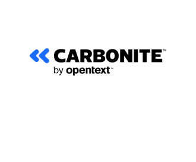](#carbonite) | [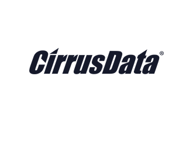](#cirrus-data) | [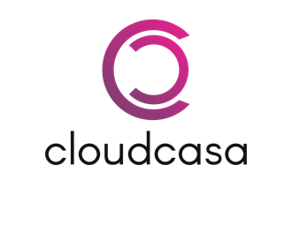](#cloudcasa--catalogic) | [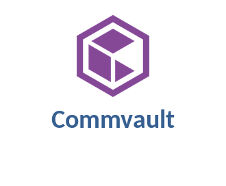](#commvault) | [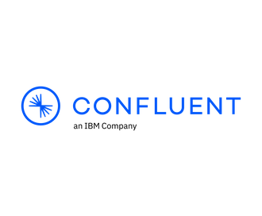](#confluent-kafka) | [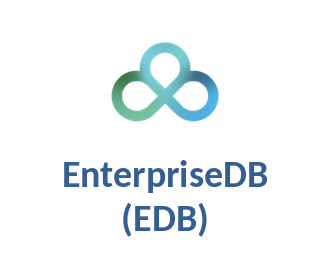](#enterprisedb-edb) |
| [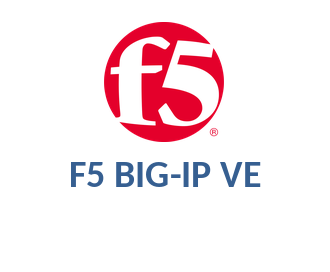](#f5-big-ip-ve) | [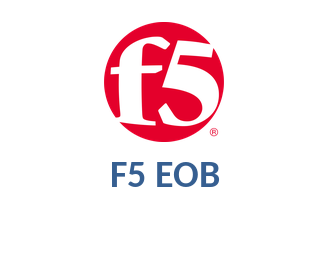](#f5-eob) | [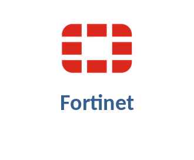](#fortinet) | [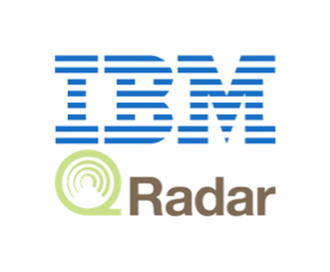](#ibm-qradar) | [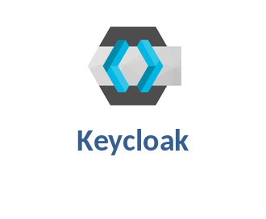](#keycloak) | [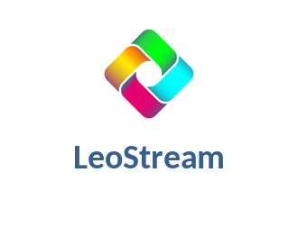](#leostream) |
| [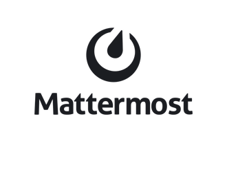](#mattermost) | [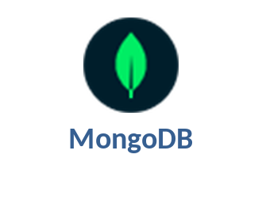](#mongodb) | [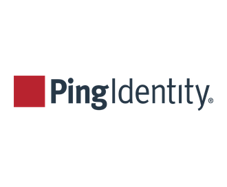](#ping-identity) | [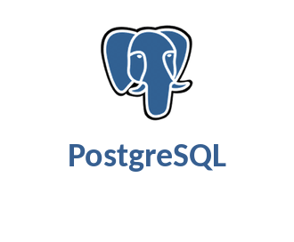](#postgresql) | [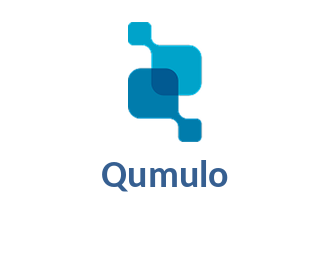](#qumulo) | [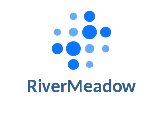](#rivermeadow) |
| [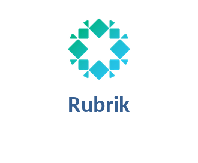](#rubrik) | [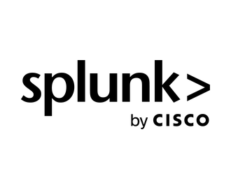](#splunk) | [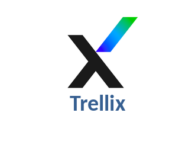](#trellix) | [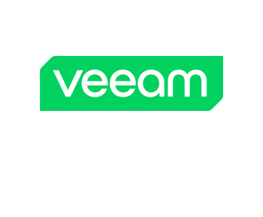](#veeam) | [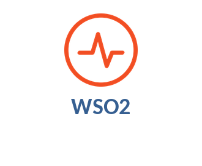](#wso2) |  |

## Security and identity

Security and identity partners help organizations control access to Azure Local workloads and protect them from threats. This category brings together identity and access management, including authentication, authorization, and single sign-on (SSO); security monitoring and security information and event management (SIEM); network security and application delivery; and endpoint protection for Azure Local hosts and workloads. Together, these solutions give operators visibility into infrastructure health and security events, keep authentication available for dependent applications, and help teams detect and contain incidents faster, which can shorten time-to-recovery. They strengthen the security posture and availability of Sovereign Private Cloud deployments, but they don't back up, replicate, or restore workloads. That role belongs to the Business Continuity and Migration category.

### F5 BIG-IP VE

F5 BIG-IP Virtual Edition (VE) delivers application delivery controller capabilities, including load balancing, traffic management, and web application security as a virtual appliance. BIG-IP VE is validated on Azure Local connected deployments. Validation in the Azure Local multi-rack lab remains in progress.

*Website: https://www.f5.com/products/big-ip-services/virtual-editions*

### F5 (EOB)

F5 eBPF Observability (EOB) is an F5 observability solution that uses extended Berkeley Packet Filter (eBPF) technology. It's built on technology from F5's August 2025 acquisition of MantisNet, an innovator in cloud-native, eBPF-powered observability and real-time network intelligence. Deployed as a guest-kernel probe, it captures low-latency network telemetry directly from the operating-system kernel of workload virtual machines and containers, giving operators deep visibility into traffic flows, including east-west traffic inside containerized environments that legacy monitoring tools typically overlook.

F5 EOB extends the F5 Application Delivery and Security Platform (ADSP) into on-premises and sovereign deployments. It can surface metadata and pre-encryption context from Transport Layer Security (TLS) 1.3 sessions, route real-time insights into BIG-IP Policy Enforcement Manager (PEM) or BIG-IP Advanced Firewall Manager (AFM) for automated policy enforcement, and support compliance through programmatic packet capture and historical flow retention. These capabilities are particularly relevant for public sector agencies, and regulated enterprises that need deep operational visibility close to their workloads.

*Website: https://www.f5.com*

### Fortinet

Fortinet is a leading network security vendor best known for its FortiGate next-generation firewalls (NGFW) and broader security fabric, covering network segmentation, intrusion prevention, and secure software-defined wide area network (SD-WAN). Its validation on Azure Local allows organizations to deploy Fortinet's security appliances as virtual machines directly on Azure Local infrastructure, extending consistent perimeter and network security policies to edge and datacenter sites without dedicated hardware.

*Website: https://www.fortinet.com*

### IBM QRadar

IBM QRadar is a security information and event management (SIEM) solution that aggregates log and event data, applies analytics, and prioritizes security incidents based on risk. Its validation on Azure Local allows enterprises with existing QRadar deployments to extend consistent threat detection and compliance monitoring to hybrid and disconnected Azure Local environments, ensuring security operations centers (SOCs) retain full visibility into on-premises virtual machine estates alongside cloud resources.

*Website: https://www.ibm.com/products/qradar*

### Keycloak

Keycloak is an open-source identity and access management (IAM) solution that supports single sign-on (SSO), social login, and identity brokering. Because it's validated on Azure Local, you can self-host a fully featured, cost-effective IAM stack on resilient local virtual machines (VMs). It suits organizations that need open-source flexibility along with the high availability of Azure Local clustering.

*Website: https://www.keycloak.org*

### Ping Identity

At Ping Identity, we help organizations secure and manage digital identities across customers, employees, partners, and non-human entities. Whether securing millions of users, fighting fraud, simplifying third-party access, or enabling passwordless experiences, establishing trust in every digital moment shouldn't slow you down. Our enterprise identity platform is designed for scale, flexibility, and integration across cloud, hybrid, and on-prem environments. By using our Runtime Identity capabilities, Ping enables organizations to adopt AI and automation by continuously verifying identity, context, and intent at every interaction, helping secure and govern AI agents in real time.

*Website: https://www.pingidentity.com*

### Splunk

Splunk is a leading platform for collecting, indexing, and analyzing machine-generated data in real time. On Azure Local, Splunk can ingest logs and metrics from the host cluster, virtual machines (VMs), and Arc-enabled resources to provide unified dashboards, alerting, and correlation searches. IT teams can detect performance degradation, security threats, or configuration drift early, which supports faster incident response and a stronger resiliency posture for VM workloads at the edge or in the datacenter.

*Website: https://www.splunk.com*

### Trellix

Trellix provides endpoint detection and response (EDR) and extended detection and response (XDR) capabilities that help security teams detect, investigate, and contain threats on hosts and workloads. Trellix is validated on Azure Local connected deployments, with the EDR agent installed on the Hyper-V layer of each host. This validation doesn't apply to Azure Local multi-rack deployments.

*Website: https://www.trellix.com*

### WSO2

WSO2 is an open-source technology provider whose platform spans API management, integration, and identity and access management (IAM). Its flagship products include WSO2 API Manager (API gateway, developer portal, and lifecycle management) and WSO2 Identity Server (IAM and customer identity). Validated on Azure Local, WSO2 lets government and regulated organizations host identity-aware API management and IAM entirely within their own datacenter or edge site, supporting compliance requirements that keep sensitive traffic and identity data on-premises.

WSO2 Identity Server includes several capabilities that help secure hybrid, edge, and regulated deployments like Azure Local:

- OpenID for Verifiable Credential Issuance (OID4VCI)
- Client-Initiated Backchannel Authentication (CIBA) grant
- OpenID Connect (OIDC) front-channel logout
- Enhanced business-to-business (B2B) and multitenant support
- Access control for noninteractive AI agents
- Security Assertion Markup Language (SAML) support for API-based authentication
- Operational hardening, including administrative APIs for enrolled user credentials, automatic certificate refresh for SAML identity providers, session lifetime enforcement, fraud detection through Sift integration, push notifications from multiple providers such as Amazon Simple Notification Service (SNS), and nonpersistent and encrypted ID tokens

On Azure Local, organizations can use WSO2 Identity Server to enforce identity-aware security, agent access governance, and modern authentication flows such as verifiable credentials and CIBA.

*Website: https://wso2.com*

## Data streaming and AI

Data streaming and AI partners help customers run data-intensive, real-time, and AI workloads close to where data is generated. This category covers databases, file data platforms, and event-streaming platforms that modern applications and AI workloads depend on for data pipelines, analytics, model training and inference, and microservices communication, with validation confirming that these workloads run reliably and with expected performance on Azure Local infrastructure. This category is a platform-compatibility and application-hosting validation, not a backup or disaster recovery (DR) capability; protecting the data still requires a backup or replication solution from the Business Continuity & Migration category.

### Confluent (Kafka)

Confluent provides an enterprise-grade, fully managed distribution of Apache Kafka, the widely adopted distributed event-streaming platform. Validation on Azure Local confirms that Confluent's Kafka-based streaming infrastructure can run reliably on Azure Local virtual machines (VMs), letting organizations process and route real-time data feeds, event pipelines, and microservices messaging close to where the data is generated — important for latency-sensitive or data-sovereign edge and datacenter deployments.

*Website: https://www.confluent.io*

### MongoDB

MongoDB is a widely adopted NoSQL, document-oriented database used for modern, high-scale applications. Validation on Azure Local confirms that MongoDB replica sets and sharded clusters can be deployed on Azure Local virtual machines (VMs) with predictable performance and storage resiliency, giving customers the flexibility to run cloud-native, data-intensive applications close to where data is generated while maintaining the availability guarantees MongoDB is known for.

*Website: https://www.mongodb.com*

### Qumulo

Qumulo is a scalable, high-performance file data platform designed for unstructured data at scale, with real-time visibility and hybrid cloud capabilities. Its validation on Azure Local extends enterprise-grade file storage and data management to Azure Local environments. It supports data-intensive workloads such as media, analytics, and backup targets that require large-scale, resilient file storage.

*Website: https://qumulo.com*

## Business continuity and migration

Business continuity and migration partners help customers protect virtual machine (VM) data and keep workloads mobile. Backup and disaster recovery solutions provide backup, replication, and recovery capabilities, ensuring workloads on Azure Local can be restored quickly after data loss, corruption, ransomware, or site failure. Migration solutions help customers move workloads onto (and off of) Azure Local with minimal downtime, enabling fast workload mobility for disaster recovery, capacity rebalancing, or platform modernization. This category is directly related to VM resiliency and is most aligned with business continuity and disaster recovery (BCDR) planning.

### Carbonite

Carbonite (an OpenText company) offers backup, disaster recovery, and workload migration solutions, including continuous data protection and system-state replication. Its validation on Azure Local allows customers to combine migration and disaster recovery capabilities, moving workloads onto Azure Local while maintaining a continuously replicated recovery point for business continuity.

*Website: https://www.carbonite.com*

### Cirrus Data

Cirrus Data provides live, host-based storage migration for virtual machines (VMs), including migrations to and from storage area network (SAN) storage or to Storage Spaces Direct (S2D). Validation on Azure Local confirmed the documented checkpoints for this capability, giving customers a validated path to move VM storage with minimal disruption.

*Website: https://www.cirrusdata.com*

### CloudCasa / Catalogic

CloudCasa by Catalogic Software is a Kubernetes- and cloud-native data protection service that also offers backup capabilities for virtual machines (VMs) and hybrid workloads. Validation on Azure Local extends modern, API-driven backup and recovery workflows to Azure Local VMs. This solution appeals to organizations adopting cloud-native operational models for their on-premises infrastructure.

*Website: https://cloudcasa.io \| https://www.catalogicsoftware.com*

### Commvault

Commvault delivers enterprise data protection, backup, and recovery across on-premises, cloud, and hybrid environments, with strong ransomware resilience and compliance features. On Azure Local, Commvault extends its unified data management capabilities to protect virtual machines (VMs) at the edge or in the datacenter. It supports centralized backup policies across a distributed Azure Local footprint. Scope note: VM migration is validated; business continuity and disaster recovery (BCDR)-specific validation is still pending per program tracking.

*Website: https://www.commvault.com*

### RiverMeadow

RiverMeadow provides an automated, agent-based cloud migration platform that moves physical, virtual, and cloud workloads with minimal manual effort. Validated on Azure Local, it gives customers a proven path to migrate legacy or cloud virtual machines (VMs) onto Azure Local without extensive re-architecture. This solution accelerates adoption and reduces the operational risk typically associated with large-scale migrations.

*Website: https://www.rivermeadow.com*

### Rubrik

Rubrik provides a unified data security and backup platform with features such as immutable backups, ransomware detection, and rapid recovery. Validation on Azure Local ensures Rubrik can protect Azure Local virtual machines (VMs) with the same policy-driven backup and instant-recovery experience customers rely on across their hybrid estate. This solution reinforces Azure Local as a resilient platform for critical workloads.

*Website: https://www.rubrik.com*

### Veeam

Veeam is one of the most widely deployed backup and replication solutions for virtualized environments, known for image-level backups, replication, and fast granular recovery. Its validation on Azure Local confirms that customers can apply their existing Veeam backup strategies — including offsite replication and backup-to-cloud — directly to Azure Local virtual machine (VM) workloads. This solution simplifies business continuity and disaster recovery (BCDR) planning for organizations already standardized on Veeam.

*Website: https://www.veeam.com*

## Application platform and DevOps

Application platform and DevOps partners help organizations build, run, and collaborate on business-critical applications within their own infrastructure. This category covers relational databases and enterprise Postgres; secure team collaboration and communications; and remote workstation and desktop access. By using these application platform validations, organizations can keep application databases, sensitive communications, and high-performance desktops on-premises for regulatory, latency, or data-sovereignty reasons. These solutions aren't resiliency tools: the resiliency of these applications still depends on standard backup and high-availability (HA) practices.

### EnterpriseDB (EDB)

EnterpriseDB (EDB) is a major contributor to the PostgreSQL open-source project and provides enterprise-grade Postgres software and support through its EDB Postgres AI platform, including EDB Postgres Advanced Server, which adds Oracle database compatibility, and EDB Postgres Distributed for high availability across nodes and sites. By using the validation on Azure Local, EDB lets organizations run commercially supported PostgreSQL on local infrastructure and modernize or migrate Oracle-based workloads, while keeping data and database operations within their own datacenter or edge site.

*Website: https://www.enterprisedb.com*

### Leostream

Leostream is a vendor-neutral remote workstation and desktop access management platform that centrally provisions, brokers, and secures access to physical, virtual, and GPU-enabled workstations across on-premises, cloud, and hybrid environments. By using the validation on Azure Local, Leostream lets organizations deliver secure, zero-trust remote access to high-performance desktops and workstations - such as those used in media, engineering, and research workloads - hosted on local infrastructure.

*Website: https://leostream.com*

### Mattermost

Mattermost is an open-source, self-hosted messaging and collaboration platform built for secure, compliance-sensitive environments. By using the validation on Azure Local, it lets government and regulated organizations run secure team chat and collaboration entirely within their own infrastructure, avoiding reliance on public cloud chat services for sensitive communications. It's an important option for regulated industries, government, and disconnected/edge sites.

*Website: https://mattermost.com*

### PostgreSQL

PostgreSQL is a widely adopted open-source relational database known for its reliability, standards compliance, and extensibility. It has a broad ecosystem of extensions that supports transactional, analytical, and geospatial workloads. By using the validation on Azure Local, PostgreSQL gives organizations an open-source relational database option for running data-tier workloads on local infrastructure, close to where data is generated, while keeping data under local control for sovereign, regulated, and edge deployments.

*Website: https://www.postgresql.org*

Together, these 23 validated ISV integrations demonstrate the breadth of the Azure Local partner ecosystem across four categories: security and identity, data streaming and AI, business continuity and migration, and application platform and DevOps. Only the Business Continuity & Migration category provides direct virtual machine (VM) resiliency capabilities. The other categories validate important supporting platforms that run on Azure Local and contribute indirectly to a well-managed, resilient environment without providing backup or recovery functionality themselves. Validation applies only to the specific capabilities and deployment configurations documented for each product.

## Next steps

To learn more about the Azure Local Validated partner solutions program, complete this [interest form](https://aka.ms/azurelocalvalidatedsolutionsinfo).