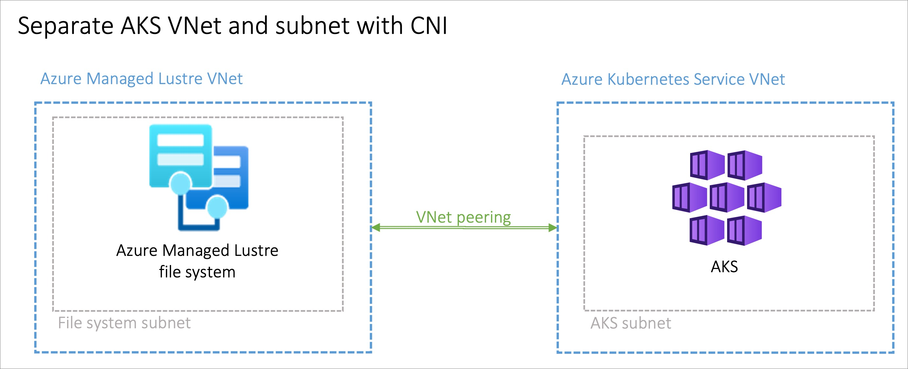
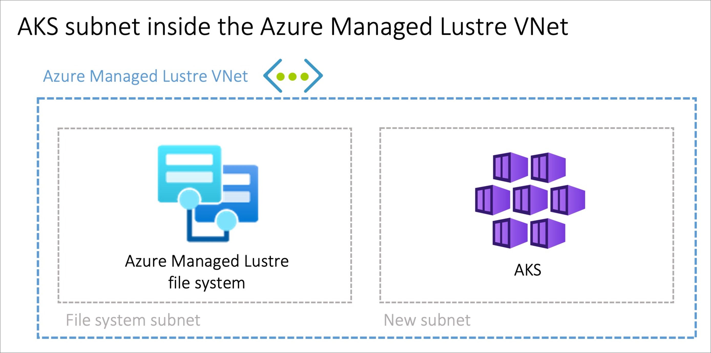

# Plan network architecture for AKS with Azure Managed Lustre

Before deploying the Azure Lustre CSI Driver for Kubernetes, you need to plan the network configuration between your Azure Kubernetes Service (AKS) cluster and your Azure Managed Lustre file system. This article covers the supported network types and architecture options for connecting AKS to Azure Managed Lustre.

## Determine the network type to use with AKS

AKS supports multiple networking models, each with different capabilities and use cases. All networking models work with the Azure Lustre CSI Driver for Kubernetes, but they have different requirements for virtual networking and cluster setup.

For comprehensive information about choosing the right networking model for your specific requirements, see [Azure Kubernetes Service CNI networking overview](/azure/aks/concepts-network-cni-overview).

When creating an AKS cluster in the Azure portal, you'll see the following networking options:

### Recommended options

**Azure CNI Overlay (Recommended)**
- Conserves VNet IP address space by using logically separate CIDR ranges for pods
- Supports maximum cluster scale (5000 nodes and 250 pods per node)
- Simple IP address management
- Best choice for most scenarios

**Azure CNI Pod Subnet**
- Pods get full VNet connectivity and can be directly reached via their private IP address
- Requires larger, non-fragmented VNet IP address space
- Choose this if you need direct external access to pod IPs

### Legacy options (not recommended for new deployments)

**Azure CNI Node Subnet (Legacy)**
- Limited scale and inefficient use of VNet IPs
- Only recommended if you specifically need a managed VNet for your cluster. See [AKS Legacy Container Networking Interfaces (CNI)](/azure/aks/concepts-network-legacy-cni)

**Kubenet (Retiring)**
- Retiring March 31, 2028. For more information, see [AKS use Kubenet](/azure/aks/configure-kubenet).
- Limited scale and requires manual route management
- Plan to migrate to Azure CNI Overlay before the retirement date

For detailed information on networking models, see [Azure Kubernetes Service CNI networking overview](/azure/aks/concepts-network-cni-overview).

## Determine the network architecture for interconnectivity of AKS and Azure Managed Lustre

Azure Managed Lustre operates within a private virtual network. Your AKS instance must have network connectivity to the Azure Managed Lustre virtual network. There are two common ways to configure the networking between Azure Managed Lustre and AKS:

- Install AKS in its own virtual network and create a virtual network peering with the Azure Managed Lustre virtual network.
- Use the **Bring your own Azure virtual network** option in AKS to install AKS in a new subnet on the Azure Managed Lustre virtual network.

> [!NOTE]
> Don't install AKS in the same subnet as Azure Managed Lustre.

### Peering AKS and Azure Managed Lustre virtual networks

Virtual network peering provides flexibility, but it requires coordination between the two networks to avoid overlapping IP address spaces.

### Installing AKS in a subnet on the Azure Managed Lustre virtual network

The option to install the AKS cluster in the Azure Managed Lustre virtual network with the **Bring your own Azure virtual network** feature in AKS can be advantageous in scenarios where you manage the network singularly. You need to create an extra subnet, sized to meet your AKS networking requirements, in the Azure Managed Lustre virtual network.

There's no privilege separation for network management when you provision AKS on the Azure Managed Lustre virtual network. The AKS service principal needs privileges on the Azure Managed Lustre virtual network.

## Related content

- [Azure Lustre CSI driver overview](use-csi-driver-kubernetes.md)
- [Use dynamic provisioning with the Azure Lustre CSI driver](use-container-storage-interface-driver-dynamic-provisioning.md)
- [Use static provisioning with the Azure Lustre CSI driver](use-container-storage-interface-driver-static-provisioning.md)
- [Virtual network peering](/azure/virtual-network/virtual-network-peering-overview)
- [Azure Kubernetes Service CNI networking overview](/azure/aks/concepts-network-cni-overview)
