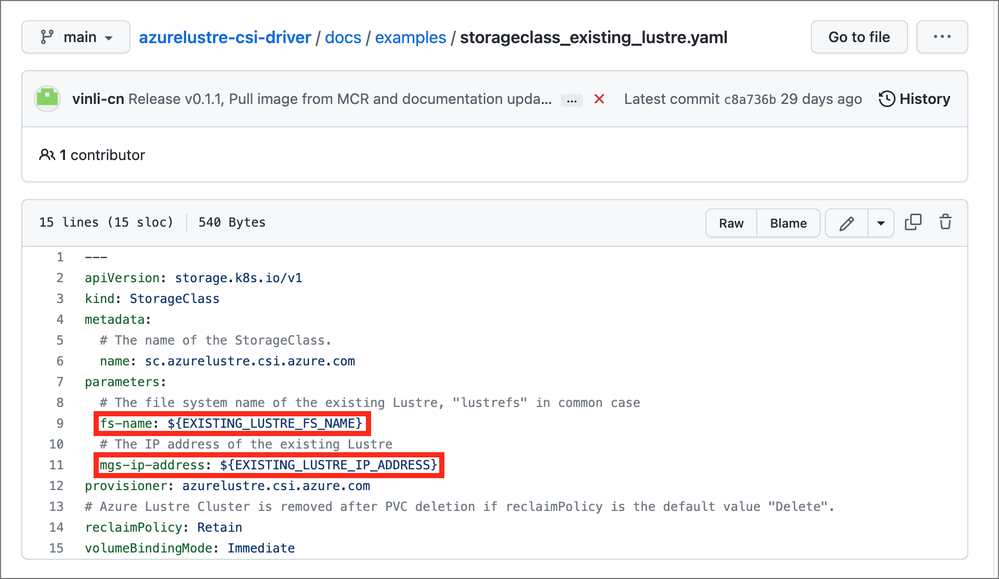
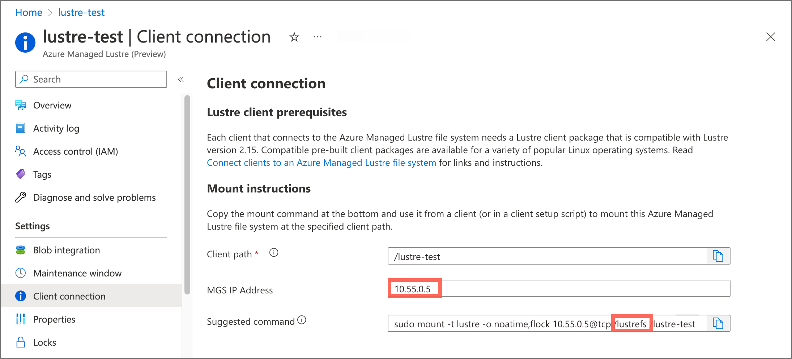

# Use static provisioning with the Azure Managed Lustre CSI driver

By using static provisioning, you can use an existing Azure Managed Lustre file system with your AKS cluster. Manually create the necessary Kubernetes resources. This method involves creating storage classes that reference existing Lustre clusters and manually specifying the Lustre file system name and MGS IP address. Use this method for scenarios where you have preexisting Lustre infrastructure.

## Prerequisites for static provisioning

- An existing Azure Managed Lustre file system. For information about creating a file system, see [Create an Azure Managed Lustre file system by using the Azure portal](create-file-system-portal.md).
- The MGS IP address and internal file system name from your Azure Managed Lustre cluster.
- An Azure account with an active subscription. [Create an account for free](https://azure.microsoft.com/pricing/purchase-options/azure-account?cid=msft_learn).
- A terminal environment with the Azure CLI tools installed. See [Get started with the Azure CLI](/cli/azure/get-started-with-azure-cli).
- [kubectl](https://kubernetes.io/docs/reference/kubectl), the Kubernetes management tool, installed in your terminal environment.
- **Network connectivity** between your AKS cluster and Azure Managed Lustre virtual network. See [Plan network architecture for AKS with Azure Managed Lustre](use-container-storage-interface-driver-network-planning.md) for configuration options.

## Create an Azure Managed Lustre file system cluster for static provisioning

If you didn't already create your Azure Managed Lustre file system cluster, create the cluster now. For instructions, see [Create an Azure Managed Lustre file system by using the Azure portal](create-file-system-portal.md). Static provisioning requires an existing Azure Managed Lustre file system.

## Create an AKS cluster for static provisioning

If you didn't already create your AKS cluster, create a cluster deployment. See [Deploy an Azure Kubernetes Service (AKS) cluster by using the Azure portal](/azure/aks/learn/quick-kubernetes-deploy-portal).

## Create a virtual network peering for static provisioning

> [!NOTE]
> Skip this network peering step if you installed AKS in a subnet on the Azure Managed Lustre virtual network.

The AKS virtual network is created in a separate resource group from the AKS cluster's resource group. You can find the name of this resource group by going to your AKS cluster in the Azure portal, going to **Properties**, and finding the **Infrastructure** resource group. This resource group contains the virtual network that needs to be paired with the Azure Managed Lustre virtual network. It matches the pattern **MC\_\<aks-rg-name\>\_\<aks-cluster-name\>\_\<region\>**.

To peer the AKS virtual network with your Azure Managed Lustre virtual network, consult [Virtual network peering](/azure/virtual-network/virtual-network-peering-overview).

> [!TIP]
> Due to the naming of the MC_ resource groups and virtual networks, names of networks can be similar or the same across multiple AKS deployments. When you're setting up peering, be careful to choose the AKS networks that you intend to choose.

## Connect to the AKS cluster for static provisioning

1. Open a terminal session with access to the Azure CLI tools and sign in to your Azure account.

   ```azurecli
   az login
   ```

1. Sign in to [the Azure portal](https://portal.azure.com).

1. Find your AKS cluster. On the **Overview** pane, select the **Connect** button, and then copy the command for **Download cluster credentials**.

1. In your terminal session, paste the command to download the credentials. The command is similar to:

   ```azurecli
   az aks get-credentials --subscription <AKS_subscription_id> --resource_group <AKS_resource_group_name> --name <name_of_AKS>
   ```

1. Install kubectl if it's not present in your environment.

   ```azurecli
   az aks install-cli
   ```

1. Verify that the current context is the AKS cluster where you just installed the credentials and that you can connect to it.

   ```bash
   kubectl config current-context
   kubectl get deployments --all-namespaces=true
   ```

## Install the driver for static provisioning

To install the Azure Lustre CSI Driver for Kubernetes, run the following command:

```bash
curl -skSL https://raw.githubusercontent.com/kubernetes-sigs/azurelustre-csi-driver/main/deploy/install-driver.sh | bash
```

To get sample commands for a local installation, see [Install the Azure Lustre CSI driver on a Kubernetes cluster](https://github.com/kubernetes-sigs/azurelustre-csi-driver/blob/main/docs/install-csi-driver.md).

## Create and configure a persistent volume for static provisioning

To create a persistent volume for an existing Azure Managed Lustre file system:

1. Copy the following configuration files from the **/docs/examples/** folder in the [azurelustre-csi-driver](https://github.com/kubernetes-sigs/azurelustre-csi-driver/tree/main/docs/examples) repository. If you cloned the repository when you [installed the driver](#install-the-driver-for-static-provisioning), you already have local copies available.

   - **storageclass_existing_lustre.yaml**
   - **pvc_storageclass.yaml**

   If you don't want to clone the entire repository, you can download each file individually. Open each of the following links, copy the file's contents, and then paste the contents into a local file with the same file name.

   - [storageclass_existing_lustre.yaml](https://github.com/kubernetes-sigs/azurelustre-csi-driver/blob/main/docs/examples/storageclass_existing_lustre.yaml)
   - [pvc_storageclass.yaml](https://github.com/kubernetes-sigs/azurelustre-csi-driver/blob/main/docs/examples/pvc_storageclass.yaml)

1. In the **storageclass_existing_lustre.yaml** file, update the internal name of the Lustre cluster and the Lustre Management Service (MGS) IP address.

   

   Both settings are displayed in the Azure portal, on the **Client connection** pane for your Azure Managed Lustre file system.

   

   Make these updates:

   - Replace `EXISTING_LUSTRE_FS_NAME` with the system-assigned internal name of the Lustre cluster in your Azure Managed Lustre file system. The internal name is usually `lustrefs`. The internal name isn't the name that you gave the file system when you created it.

     The suggested `mount` command includes the name highlighted in the following address string.

     

   - Replace `EXISTING_LUSTRE_IP_ADDRESS` with the MGS IP address.

1. To create the storage class and the persistent volume claim, run the following `kubectl` command:

   ```bash
   kubectl create -f storageclass_existing_lustre.yaml
   kubectl create -f pvc_storageclass.yaml
   ```

## Create a pod for static provisioning

Create a pod that uses the PVC to mount the Azure Managed Lustre file system.

Create a file called `pod_echo_date.yaml` and copy in the following YAML:

```yaml
apiVersion: v1
kind: Pod
metadata:
  name: lustre-echo-date
spec:
  containers:
  - image: mcr.microsoft.com/oss/nginx/nginx:1.15.5-alpine
    name: lustre-echo-date
    command:
      - "/bin/sh"
      - "-c"
      - "while true; do echo $(date) >> /mnt/lustre/outfile; sleep 1; done"
    volumeMounts:
    - name: lustre-storage
      mountPath: /mnt/lustre
  volumes:
  - name: lustre-storage
    persistentVolumeClaim:
      claimName: pvc-lustre
```

Apply the pod to your AKS cluster:

```bash
kubectl apply -f pod_echo_date.yaml
```

## Verify static provisioning

After the pod is running, you can verify that the Azure Managed Lustre file system is mounted correctly:

```bash
kubectl exec -it lustre-echo-date -- df -h
```

You should see the Azure Managed Lustre file system mounted at `/mnt/lustre`.

To view timestamps in the console during writes, run the following command:

```bash
kubectl logs -f lustre-echo-date
```

## Clean up static resources

To clean up resources when you're done:

```bash
kubectl delete pod lustre-echo-date
kubectl delete pvc pvc-lustre
kubectl delete storageclass azurelustre-static
```

> [!IMPORTANT]
> This step only deletes the Kubernetes resources. The Azure Managed Lustre file system itself continues to exist and can be reused.

## Troubleshooting

For troubleshooting issues with the Azure Lustre CSI Driver, see the [CSI driver troubleshooting guide](https://github.com/kubernetes-sigs/azurelustre-csi-driver/blob/main/docs/csi-debug.md) in the GitHub repository.

Common issues for static provisioning include:

- **Network connectivity problems** between AKS and Azure Managed Lustre - verify virtual network peering or subnet configuration.
- **Incorrect configuration** - double-check the MGS IP address and file system name in your storage class configuration.
- **Pod scheduling issues** - ensure you're using Ubuntu Linux OS SKU for node pools, as this is the only supported configuration.
- **Permission issues** - verify that the AKS service principal has appropriate permissions on the Azure Managed Lustre virtual network.

For additional troubleshooting resources, see:
- [Azure Managed Lustre troubleshooting](troubleshoot-deployment.md)
- [Azure Lustre CSI Driver GitHub repository](https://github.com/kubernetes-sigs/azurelustre-csi-driver)

## Related content

- [Azure Lustre CSI driver overview](use-csi-driver-kubernetes.md)
- [Plan network architecture for AKS with Azure Managed Lustre](use-container-storage-interface-driver-network-planning.md).
- [Use dynamic provisioning with the Azure Lustre CSI driver](use-container-storage-interface-driver-dynamic-provisioning.md)
- [Validate CSI driver image security](use-container-storage-interface-driver-image-security.md).
